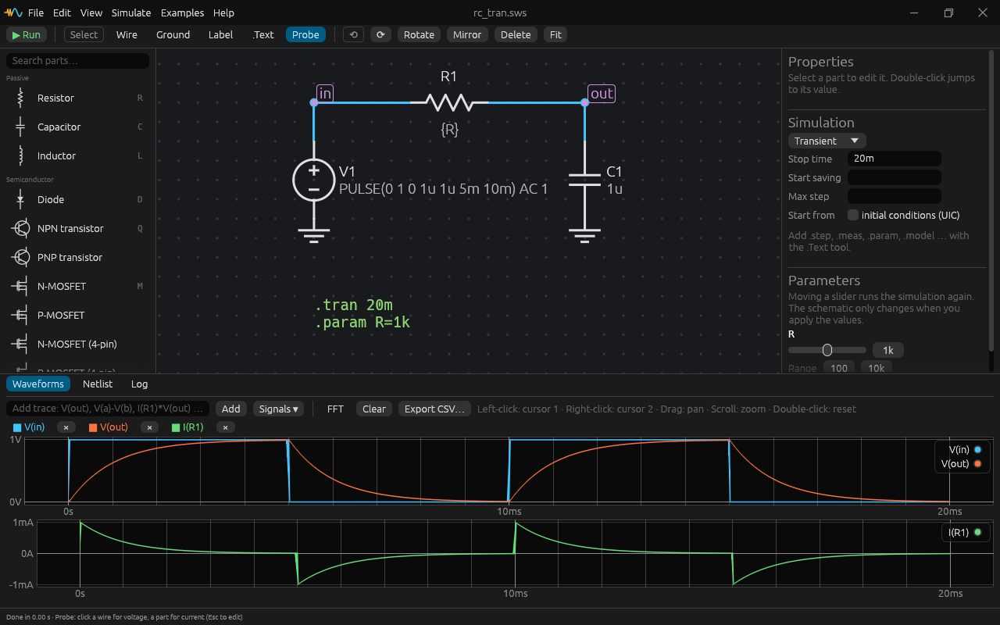
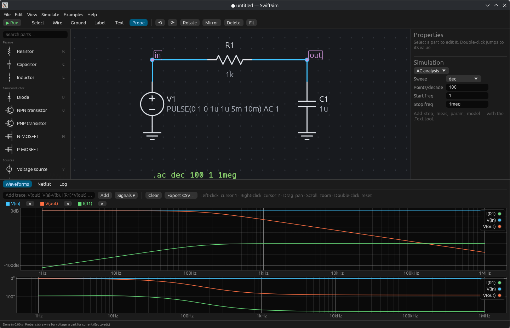

# SwiftSim

A fast, open-source SPICE circuit simulator with a modern schematic editor and
waveform viewer — an alternative to LTSpice for Linux and Windows.
Single native binary, written in Rust (egui GUI, own simulation engine).




## Build & run

Requires Rust 1.85+ (edition 2024).

```bash
cargo build --release
```

```bash
./target/release/swiftsim                  # GUI (opens an example)
./target/release/swiftsim my.sws           # open a schematic
./target/release/swiftsim my.cir           # open a SPICE netlist in the text editor
./target/release/swiftsim -b my.cir -o out.csv   # batch run, log + CSV export
```

On Windows the same commands produce `swiftsim.exe` (no console window in release builds).

## What works today

**Simulator engine** (`src/`, usable as a library)
- Analyses: `.op`, `.tran` (adaptive trapezoidal with LTE control, breakpoints, `uic`),
  `.ac` (dec/oct/lin), `.dc` (one or two nested sweeps)
- `.step` (param / source / element; lin, dec, oct, list; nested), `.meas`
  (AVG, MAX, MIN, PP, RMS, INTEG, FIND…AT, FIND…WHEN, WHEN, TRIG/TARG, PARAM),
  `.param` with expressions, `.func` user functions (global or per `.subckt`), `.ic`,
  `.options`, `.model`, `.subckt` with `params:`,
  `.include` / `.lib` (incl. sections)
- Elements: R, C (Rser/Rpar, IC), L (Rser, IC), K (mutual coupling), V/I with DC, AC,
  PULSE, SIN/SINE, EXP, PWL, SFFM (V: Rser), D (junction caps, breakdown/zener),
  Q (Gummel-Poon DC, junction/diffusion charge, RB/RC/RE), M (level 1 and LTSpice VDMOS
  with body diode), J (NJF/PJF JFET: VTO, BETA, LAMBDA, IS, N, RD, RS, CGS, CGD, PB, M, FC),
  E/F/G/H incl. `POLY(n)`, E/G `value={…}` and `table=(…)` / `TABLE {expr}=(…)`,
  B (behavioral V=/I= with `V()`, `I()`, `time`, `if()`, math), S (voltage switch with
  hysteresis), X (subcircuits)
- Vendor macromodels in the classic PSpice style run unmodified, e.g. TI's TL072 and
  LM358 (checked in `tests/models/`)
- Expressions: `+ - * / ** ^`, comparisons, `&& ||`, `?:`, `if`, `min/max/limit`,
  trig/exp/log, `u()`, `uramp()`, `table(x, x1,y1, …)`, Monte Carlo `mc() gauss() flat() rand()`
- LTSpice conventions: SI suffixes (`4k7`, `1meg`, `10uF`), `;` comments, inductor
  default Rser = 1 mΩ, current sign conventions (I(V1) into +, Ic into collector…)
- Convergence aids: pn-junction and FET voltage limiting, gmin stepping, source stepping
- Built-in parts: 1N4148, 1N4007, 1N5819, zeners, LEDs, 2N3904/3906, 2N2222/2907,
  BC547B/557B, TIP31C/32C, 2N7000, BS170, BSS84, IRF540N, IRF9540N, IRLZ44N,
  generic NMOS/PMOS (approximate datasheet-level models)

**Desktop app**
- Schematic editor: part palette with search and icons, grid snapping, wires with
  L-routing and T-junction detection, net labels, ground, SPICE directive text,
  rotate/mirror, box select, rubber-band wires when dragging parts, copy/paste,
  undo/redo, zoom/pan/fit, junction dots, unconnected-pin markers
- Properties panel: values, model picker (built-in + your `.model`s), structured
  source editor (DC / Pulse / Sine / Exp / PWL + AC), simulation-command form
- Simulation runs in the background with progress and Stop
- Probe: click a wire → voltage, click a part → current; labeled nets auto-plot
- Waveforms: separate V and A panes on a shared axis, Bode plots (dB + phase, log
  axis), stepped runs overlaid, arbitrary trace expressions (`V(a)-V(b)`,
  `I(R1)*V(out)`), FFT, two cursors with Δ and 1/Δ readout, CSV export
- `.op` voltages annotated on the schematic; Log shows OP tables, `.meas`, warnings
- Netlist mode: edit and run any SPICE netlist directly (LTSpice `.net/.cir` files)
- Dark / light theme; schematics saved as JSON (`.sws`)

### Keyboard

| Key | Action | Key | Action |
|---|---|---|---|
| R C L D V I Q M U | place part | Ctrl+R / Ctrl+E | rotate / mirror |
| G / N | ground / net label | Ctrl+Z / Ctrl+Y | undo / redo |
| W or F3 | wire | Ctrl+C / V / X / D | copy / paste / cut / duplicate |
| T or `.` | SPICE directive | Del | delete |
| P | probe | Space | zoom to fit |
| Esc | cancel / select tool | F5 | run |

Pan with middle or right drag, zoom with the wheel.

## Not yet supported (compared with LTSpice)

Being explicit, since the goal is LTSpice parity:

- Analyses: `.noise`, `.tf`, `.four`, `.temp` / temperature dependence (everything is 27 °C)
- Devices: MESFET, transmission lines (T/O), current-controlled switch (W),
  MOSFET levels above 1 / BSIM (they run with level-1 equations and a warning in the Log),
  LTSpice digital/XSPICE `A` devices, E/G `laplace=`
- JFET extras: gate recombination current (ISR/NR), impact ionization (ALPHA/VK), the
  B (doping tail) parameter and noise parameters are ignored
- `.func` functions are not visible in `.meas` expressions
- Import of LTSpice `.asc` schematics and `.asy` symbols; hierarchical schematics; custom symbols
- Sparse matrix solver: the engine uses dense LU with sparse-aware elimination —
  fast up to a few hundred nodes, slow for multi-thousand-node netlists
- VDMOS gate-drain capacitance is constant (LTSpice's is voltage-dependent); level-1
  MOSFETs have constant (non-Meyer) capacitances
- Waveform-file export in `.raw` format

## Layout

```
src/expr.rs      numbers with SI suffixes, expression parser/evaluator
src/solver.rs    MNA matrix, LU (real + complex)
src/devices.rs   device models and stamps
src/netlist.rs   parser, subcircuit flattening, models, built-in library
src/sim.rs       OP / DC / AC / transient, .step orchestration
src/measure.rs   .meas and plot expressions
src/gui/         app shell, schematic model + netlister, canvas editor, waveform viewer
tests/engine.rs  analytic checks (RC/RL/LC, AC, diodes, BJT, MOS, JFET, POLY/table/.func, .meas …)
tests/models/    public vendor macromodels used by the tests
```

```bash
cargo test --release
```
